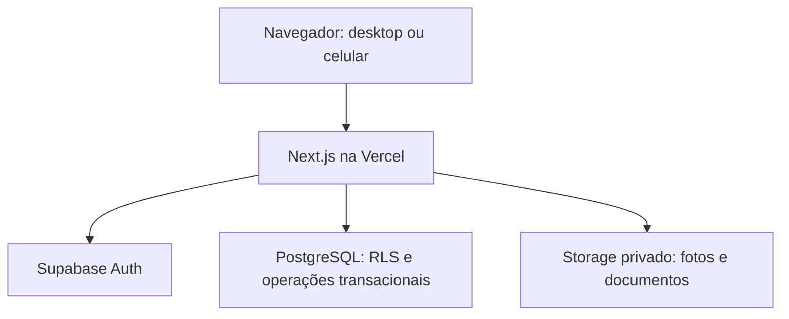

# 05 — Arquitetura da solução

## Proposta

Aplicação modular única em Next.js/TypeScript, com UI React e operações de servidor na Vercel. Supabase fornece Auth, PostgreSQL e Storage. Esta escolha é proposta para o cenário de hospedagem solicitado; experiência .NET pode ser aproveitada nos princípios de domínio e testes, sem introduzir outra hospedagem no MVP.

Bibliotecas propostas: Tailwind CSS e componentes acessíveis baseados em shadcn/ui, React Hook Form + Zod, cliente Supabase e integração SSR oficial. Biblioteca decimal para cálculo no servidor. Vitest para unidade; Playwright para E2E; testes SQL/integração para RLS e transações. Confirmar versões estáveis e compatibilidade ao iniciar; não fixar aqui versões que podem envelhecer.



## Fronteiras

- UI: formulário, navegação, renderização e validação de conveniência.
- Application: casos de uso, autorização do contexto, DTO e validação de entrada.
- Domain: cálculo, regras e transições; não acoplar regra financeira a componente React.
- Infrastructure: clientes Supabase, queries, RPC, Storage, logging.
- Banco: constraints, RLS e transações atômicas para operações críticas. Não tentar simular transação com várias chamadas independentes ao Supabase.

Server Actions e/ou Route Handlers são adaptadores. Para integração externa documentada usar `/api/v1`; formulários internos podem chamar a mesma camada de aplicação por Server Actions. Não duplicar regra entre esses caminhos.

## Estratégia de acesso ao banco

1. Leituras comuns usam identidade/JWT do usuário e RLS, com DTOs explícitos. Tabelas com dados internos sensíveis não recebem SELECT direto para `authenticated`; servir por RPC de projeção autorizada.
2. Revogar INSERT/UPDATE/DELETE direto das tabelas de negócio para `anon` e `authenticated`. Todas mutations passam por RPCs que validam ator, contexto, permissão e invariantes.
3. RPCs privilegiadas devem ter executor dedicado, sem BYPASSRLS e sem ser dono das tabelas. Habilitar RLS e políticas para esse papel. `SECURITY DEFINER` exige `search_path` fixo seguro, objetos qualificados e grants mínimos. Não usar dono `postgres` como solução automática para RPC de negócio.
4. Se o ambiente não permitir o papel dedicado com segurança, revisar ADR antes de implementar; não retirar RLS ou usar chave administrativa como atalho.
5. `auth.uid()` identifica o ator; `tenant_id`/`membership_id` recebidos são somente seleção validada. Consultar vínculo atual no banco em todas as operações.
6. Operações de Auth Admin, como convites, são adaptadores exclusivos do servidor com chave secreta, validação administrativa explícita e auditoria. A chave não participa do CRUD comum.

## Organização proposta

```text
src/
  app/                       # rotas, layouts, actions e handlers
  modules/
    identity/
    tenants/
    customers/
    catalog/
    pricing/
    orders/
    finance/
    commissions/
    reports/
  components/ui/
  lib/auth/
  lib/supabase/
  lib/observability/
supabase/
  migrations/
  tests/
  seed.sql
tests/e2e/
specs/
docs/
```

Dentro de cada módulo, separar schemas/DTOs, casos de uso, regras puras e acesso a dados conforme o volume. Evitar criar dezenas de camadas vazias para um cadastro simples.

## Cache e execução

Páginas e respostas privadas não usam cache público/ISR compartilhado. Padrão: leitura dinâmica por sessão. Caches eventuais precisam incluir tenant, usuário/escopo, cliente e versão de autorização. Invalidar após troca de contexto, alteração de vínculo e mutations.

Nenhum estado de sessão ou carrinho depende de memória da instância Vercel. Sem processo infinito, cron em memória ou gravação persistente no disco da função. Relatórios do MVP limitados; carga maior vira job persistido em fase futura.

## Operações críticas no banco

Submeter pedido, confirmar pedido, cancelar pedido, receber, estornar, pagar e reverter comissão são transações individuais. Incluem locks, idempotência, versão esperada, fatos financeiros e auditoria. O servidor web faz uma chamada atômica por operação, não várias inserções soltas.
