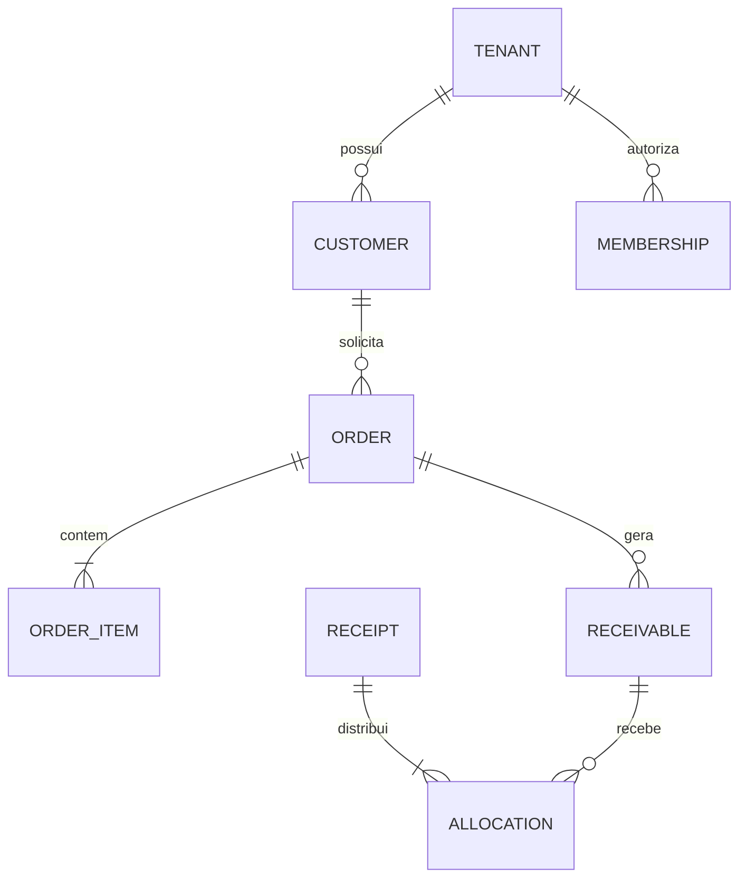

# 06 — Modelo lógico de dados

Modelo para orientar migrations futuras; não é DDL executável. IDs UUID, instantes `timestamptz`, datas de vencimento `date`, dinheiro `numeric(18,2)`, percentuais `numeric(7,4)`, quantidades inteiras positivas. Dinheiro via JSON como string decimal. Avaliar limites do negócio antes de ampliar precisão.

Implementação parcial F1.A: tenants, profiles, memberships, customers mínimos,
invitations (estrutura), audit_events e idempotency_keys. Profiles acrescenta
status global restrito ao operador; tenants/memberships têm revision e
updated_at. Auditoria acrescenta actor_kind/actor_membership_id para distinguir
operador de plataforma e usuário. F2.A acrescenta a customers contato/endereço
JSON, revision, updated_at e document_key gerado normalizado, único por tenant;
F2.C acrescenta FKs compostas price_list_id/payment_term_id. A tabela técnica privada provision_requests
guarda idempotência anterior à criação do tenant (ADR-011). A tabela abaixo
continua representando o modelo completo pretendido; detalhes do incremento em
[fundação de identidade](15-identidade-fundacao.md).

F2.A restringe SELECT de authenticated às colunas mínimas de identificação de
customers. Contato/endereço e carteira são projetados por RPC e pelo papel do
contexto selecionado; campos desconhecidos dos JSONs não são encaminhados.
Documento empresarial é comparado por letras/números maiúsculos sem pontuação,
sem validação fiscal externa. Escritas compartilham lock do tenant com F1,
exigem revisão nas atualizações e persistem auditoria/idempotência na mesma
transação. Detalhes em [clientes e carteira](18-clientes-carteira.md).

## Entidades

F2.C concretiza price_lists/price_list_versions/price_list_items,
commission_tables/commission_versions/commission_items, payment_terms e
seller_commission_assignments (migration 20261027020000). São 17 tabelas de
negócio com FORCE RLS e 40 RPCs públicas autorizadas. Versões publicadas e itens
são imutáveis; exclusões GiST impedem períodos sobrepostos. Contador, revisão,
idempotência e auditoria são transacionais. Detalhes em docs/20 e ADR-017;
catálogo buyer, pedidos e snapshots continuam futuros.

F1.C acrescenta a invitations: expires_at, delivery_token, lease_until,
attempt_count (até 5), failure_code, accepted_by_user_id,
accepted_membership_id e acceptance_response. O vínculo aceito tem FK composta
por tenant; a identidade Auth é global. Aprovação aberta é única por
tenant/e-mail/função/cliente. accepted e cancelled são terminais; uma nova
aprovação é outro registro. Projeções administrativas nunca expõem token de
entrega, resposta privada de idempotência ou credenciais do Auth.

| Tabela | Campos/relações centrais |
| --- | --- |
| tenants | id, legal_name, trade_name, document, timezone, status, contact, address |
| profiles | user_id FK auth.users, display_name; sem senha e sem função global |
| memberships | id, tenant_id, user_id, role, customer_id opcional, status |
| invitations | id, tenant_id, email, role, customer_id, state, provider_reference; sem token em log |
| customers | id, tenant_id, document, name, contact, address, seller_membership_id opcional, price_list_id, payment_term_id, status |
| products | id, tenant_id, sku, name, description, category textual, sales_unit, package_content, min_quantity, quantity_multiple, photo_id opcional, active, revision, created_at, updated_at |
| product_photos | id, tenant_id, product_id, actor_user_id, object_path, checksum, state pending/active/retired, expires_at, purged_at, created_at |
| price_lists | id, tenant_id, name, active |
| price_list_versions | id, tenant_id, price_list_id, version, valid_from, valid_until, state |
| price_list_items | id, tenant_id, version_id, product_id, unit_price |
| commission_tables | id, tenant_id, name, active |
| commission_versions | id, tenant_id, table_id, version, valid_from, valid_until, default_rate, state |
| commission_items | id, tenant_id, version_id, product_id, rate |
| seller_commission_assignments | id, tenant_id, seller_membership_id, table_id, valid_from, valid_until |
| payment_terms | id, tenant_id, name, installments, first_due_days, interval_days, active |
| orders | id, tenant_id, number, customer_id, seller_membership_id, author_user_id, status, total, revision, submitted_at, confirmed_at, delivered_at, cancellation_reason |
| order_items | id, tenant_id, order_id, product_id, sku_snapshot, name_snapshot, unit_snapshot, quantity, unit_price, line_total, price_version_id |
| order_item_commissions | id, tenant_id, order_item_id, commission_version_id, rate_snapshot, commission_total; acesso interno |
| order_events | id, tenant_id, order_id, from_status, to_status, actor_user_id, reason, occurred_at |
| receivables | id, tenant_id, order_id, customer_id, installment_number, original_amount, due_date, cancelled_at; saldo derivado |
| receipts | id, tenant_id, customer_id, amount, received_date, method, reference, actor_user_id, recorded_at |
| receipt_allocations | id, tenant_id, receipt_id, receivable_id, amount |
| receipt_order_processing | id, tenant_id, receipt_id, order_id, sequence; ordem de processamento por pedido sob lock |
| receipt_reversals | id, tenant_id, receipt_id único, reason, actor_user_id, recorded_at |
| receipt_documents | id, tenant_id, receipt_id único, number, issuer_snapshot, customer_snapshot, issued_at; anulada via reversão |
| commission_entries | id, tenant_id, receipt_id, order_item_id, seller_membership_id, amount, occurred_at |
| commission_entry_reversals | id, tenant_id, commission_entry_id único, receipt_reversal_id, amount, occurred_at |
| commission_payments | id, tenant_id, seller_membership_id, amount, paid_date, method, reference, actor_user_id |
| commission_payment_items | id, tenant_id, payment_id, commission_entry_id |
| commission_payment_reversals | id, tenant_id, payment_id único, reason, actor_user_id, recorded_at |
| audit_events | id, tenant_id, actor_user_id, action, entity_type, entity_id, safe_metadata, request_id, occurred_at |
| idempotency_keys | id, tenant_id, actor_user_id, operation, key, payload_hash, result_reference, response, created_at |
| tenant_counters | tenant_id, kind, next_number; incremento transacional por tipo |

## Relações principais

F2.B concretiza produtos e fotos conforme ADR-016. Categoria é rótulo textual,
sem tabela categories neste recorte. SKU normalizado em maiúsculas/trim é único
por tenant. product_photos referencia products por (tenant_id,product_id);
products.photo_id usa FK (tenant_id,id,photo_id) para impedir trocar foto com
outro produto/tenant. Há no máximo uma foto ativa e uma pendente por produto.
Path UUID da reserva nunca muda. Nenhum SELECT/DML direto para authenticated.

## Constraints obrigatórias

- Todas as tabelas comerciais têm `tenant_id NOT NULL`, inclusive itens, documentos, eventos e associações.
- Cada pai tem `UNIQUE(tenant_id,id)`. Filhos usam FK `(tenant_id,parent_id)` para impedir referência entre tenants mesmo em erro de aplicação.
- `memberships`: buyer exige customer_id; admin/seller exigem customer_id nulo. Unicidade parcial para `(tenant_id,user_id,role)` em funções internas e `(tenant_id,user_id,customer_id)` em buyer; não depender de UNIQUE com NULL para impedir duplicata.
- `customers.seller_membership_id` e atribuições de comissão exigem vínculo seller do mesmo tenant; constraint/trigger ou RPC valida função. Bloquear alteração da função de seller referenciado; desativar e criar outro vínculo se necessário.
- SKU e documento de cliente únicos por tenant. Documento de fornecedor único globalmente conforme proposta de uma empresa jurídica por tenant; rever para filiais se necessário.
- Versão publicada não editável. Proibir vigência sobreposta da mesma tabela; usar exclusão por intervalo ou validação serializada. Proibir sobreposição de atribuição de tabela de comissão para mesmo seller.
- Item único por `(tenant_id,order_id,product_id)`; preço/quantidade/total positivos. Percentual entre 0 e 100.
- Título único por `(tenant_id,order_id,installment_number)`; número de pedido e recibo únicos por tenant.
- Recebimento e pagamento têm valor positivo; alocação positiva. Soma e saldo verificados dentro de transação, não apenas CHECK de linha.
- Sequência de processamento única por `(tenant_id,order_id,sequence)` e um registro por recebimento/pedido; usada para limitar estornos à ordem inversa.
- Ganho único por `(tenant_id,receipt_id,order_item_id)`. A reversão usa referência única ao evento de origem.
- Item de comissão não pode pertencer a dois pagamentos efetivos. Manter histórico de associações; ao reverter pagamento, liberar seleção através de ledger de estado/constraint transacional que considere reversões. Não usar UNIQUE permanente que impeça pagar novamente após reversão.
- Operação de pagamento trava os ganhos selecionados, consulta vínculos de pagamentos não revertidos e insere atomicamente. Constraint trigger sob o mesmo lock reforça que não existam associações ativas concorrentes.
- Idempotência única por `(tenant_id,actor_user_id,operation,key)`. Persistir pelo prazo do histórico do fato, sem limpeza prematura no MVP.
- Campos de controle como tenant, autor, status e snapshots não podem ser escritos diretamente por authenticated.
- `ON DELETE RESTRICT` em referências históricas; desativação para cadastros. Mudança de estado e remoção de Auth não podem apagar fatos financeiros em cascata.

## Índices iniciais

Começar por `(tenant_id,status)`, memberships `(user_id,status,tenant_id)`, customers `(tenant_id,seller_membership_id)`, products `(tenant_id,sku)`, orders `(tenant_id,customer_id,submitted_at DESC)`, receivables `(tenant_id,customer_id,due_date)`, allocations `(tenant_id,receivable_id)`, commission_entries `(tenant_id,seller_membership_id)` e índices das FKs. Confirmar planos com volume representativo.

## Saldos e projeções

Saldo do título = original − alocações de recebimentos não revertidos; título cancelado não entra em aberto. Nunca somar original e baixas como se fossem débitos distintos.

Disponível de comissão = ganhos não revertidos − itens em pagamentos não revertidos. Projeções devem separar data financeira, instante técnico e data de emissão.

Tabelas sensíveis de comissão/auditoria e registros de idempotência não recebem SELECT amplo de authenticated. RPC retorna somente colunas autorizadas. Se houver views expostas, exigir comportamento de invocador e revisão de privilégios; views não podem virar bypass.
